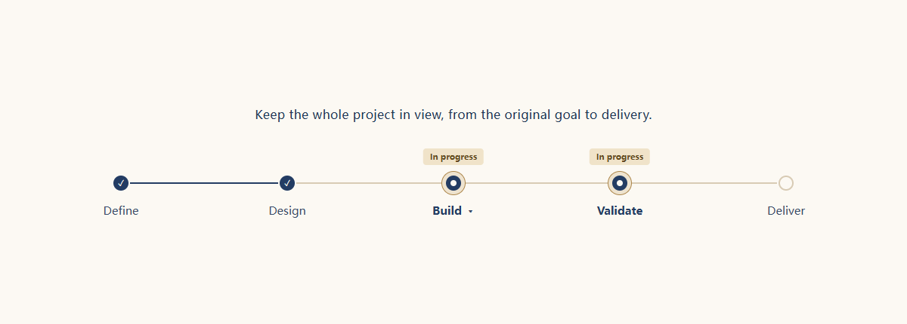
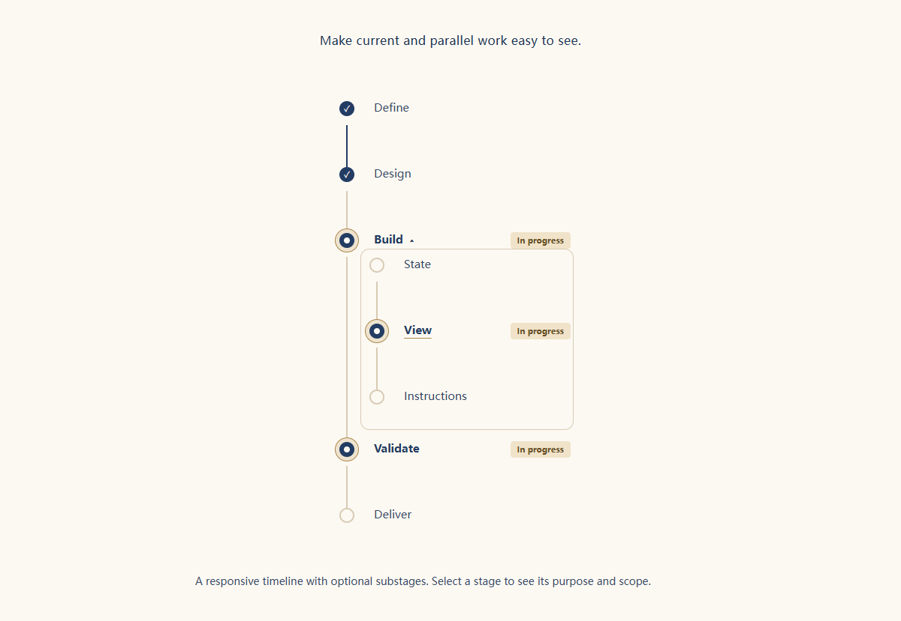
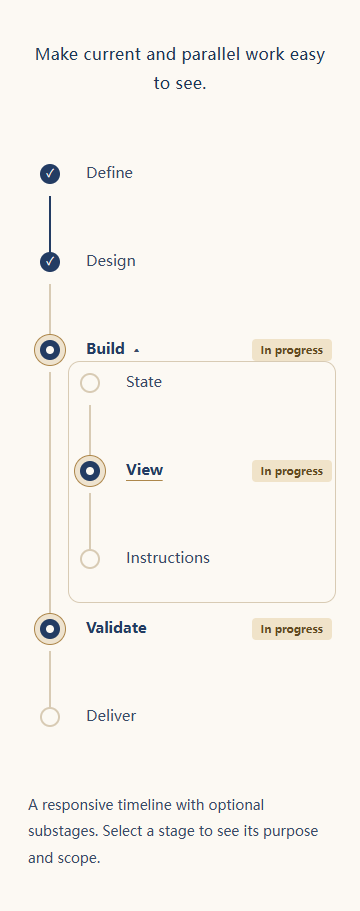

# Mainline · 项目主线轴

**和 AI 工作时，始终看得见整个项目。**

[直接体验](https://louie-lopez.github.io/mainline/?lang=zh) · [English](README.md) · [下载版本](https://github.com/Louie-Lopez/mainline/releases) · [反馈问题](https://github.com/Louie-Lopez/mainline/issues)

长对话会不断累积修改、实验和临时插问。最新任务容易取代整个项目，已经完成的工作难以找回，“本轮做完了”也容易被误当成“项目完成了”。Mainline 用**一句项目主线和一条覆盖项目从启动到完成的阶段轴**，让你直接看到：当前工作属于哪里、哪些环节正在推进、还有哪些没有完成，减少反复翻阅对话的负担。



[交互演示](https://louie-lopez.github.io/mainline/?lang=zh)无需安装。可以查看示例项目、展开环节，或切换并行推进、修复错误、交付等状态。演示复用正式工具的展示代码，使用虚构数据，不连接 AI。

Mainline 是配合 AI 助手使用的本地项目视图。你让 AI 记录项目目标、阶段和进展，它把记录保存在你的机器上，你在浏览器中查看。安装后，只需对 AI 说：

> 用 Mainline 跟踪这个项目的全生命周期，把当前任务放到对应环节，只在进展有意义地变化时更新。

## 核心能力

- **保留项目全景。** 阶段从已约定的起点覆盖到最终成果，除非项目范围有重大变化，否则保持稳定。
- **明确当前位置。** 支持多个环节同时活动，可用“修复错误”“验证结果”等短标签表达工作性质。
- **按需查看细节。** 点击环节切换到它的一句话目标、可选说明与一层子环节，总览不堆积细节。
- **跨对话恢复。** 同项目沿用同一份本地状态，避免每次从聊天记录重建进度。
- **保持低负担。** 浏览、点击、刷新都不调用模型；页面每 30 秒读取本地状态，隐藏后暂停。AI 只记录有意义的变化。

这条轴表示项目阶段的先后顺序，不表示实际耗时。进展来自 AI 的明确更新，因此记录是否准确取决于更新是否可靠。Mainline 帮助你发现偏离、接续工作，不会独立监听对话或验证完成情况。AI 读取使用规则和执行更新，仍会使用正常的对话上下文与工具调用。

<details>
<summary>查看展开环节和窄窗口效果</summary>





</details>

## 适合哪些环境？

Mainline 的记录和网页展示不绑定某个模型。能否接入，主要取决于 AI 工具能否读取操作说明、运行 Python，以及访问项目的本地文件。

| 使用环境 | 当前支持情况 |
| --- | --- |
| Codex 桌面端、本地执行 | 主要使用方式，已在 Windows 验证安装和使用，可在对话旁打开视图。 |
| 其他能执行本地操作的 AI 助手 | 可以复用同一份操作说明和运行文件；安装及打开页面的方式需要逐个验证。 |
| 在终端中使用的 AI 助手 | 可以更新记录，用户通过独立浏览器查看。 |
| 远程 Agent、纯云端聊天 | 需要让用户的浏览器能够连接到运行 Mainline 的机器；当前未提供远程连接配置。 |

当前版本是公开测试版，尚未验证其他 AI 工具以及 macOS、Linux。

## 安装

需要 **Python 3.10+** 和现代浏览器。Mainline 本身不需要额外 Python 包、API 密钥、账号或云服务。

选择 Codex 插件或独立的 [Agent Skills](https://agentskills.io/home) 技能包即可，两者功能相同，只装一种以免重复加载。Mainline 在浏览器面板或独立浏览器中展示，由 AI 明确更新进展。

### Codex：安装插件

让 Codex 从本仓库安装 Mainline，或执行：

```sh
codex plugin marketplace add Louie-Lopez/mainline
codex plugin add mainline@mainline-tools
```

这两条命令先将本仓库登记为安装来源，再安装 Mainline。之后开启新对话，选择 Mainline 或调用 `$mainline`，要求它跟踪项目。支持浏览器面板时，AI 可以直接打开视图；其他情况下提供链接。

本仓库安装来源与 OpenAI 公共插件目录相互独立，Mainline 尚未提交该目录审核。[版本下载页](https://github.com/Louie-Lopez/mainline/releases)也提供插件 ZIP，能否直接导入取决于对应 AI 工具的支持情况。安装机制参见官方的[插件说明](https://developers.openai.com/plugins/build/plugins)。

### Codex 或其他 AI 助手：安装独立技能

完整技能位于 [`plugin/skills/mainline`](plugin/skills/mainline)。按所用 AI 工具的技能安装方式导入这个目录，保留其中三个文件；只复制 `SKILL.md` 无法运行。安装工具会从仓库中自动找到这个目录。

如果已安装 Node.js 22.20 或更新版本，也可以通过社区的 [skills 安装工具](https://github.com/vercel-labs/skills)安装，并选择要接入的 AI 工具：

```sh
npx skills add Louie-Lopez/mainline --skill mainline
```

该安装方式已在 Windows 上针对 Codex 验证。Node.js 仅用于这个安装工具。它的匿名安装统计用于 [skills.sh 技能发现](https://www.skills.sh/docs/faq)，可通过环境变量 `DISABLE_TELEMETRY=1` 关闭；Mainline 本身不收集统计。

在 Codex 中，可以对内置的技能安装器说：

```text
用 $skill-installer 安装以下目录中的技能：
https://github.com/Louie-Lopez/mainline/tree/main/plugin/skills/mainline
```

已经单独安装技能的用户可以继续使用，功能与插件相同。其他 AI 工具需要确认如何加载 Agent Skills，以及是否允许在本地运行 Python。共用技能格式便于复用，但不代表本版本已在所有支持该格式的工具中验证。

## 多语言

界面内置英文和简体中文，跟随浏览器语言，未匹配时使用英文。在返回的地址后加 `?lang=zh` 或 `?lang=en` 可指定语言，不额外增加界面控件。

主线、阶段名、说明和自定义标签保留用户编写的语言，让 AI 按你的语言填写即可。没有后台翻译或额外模型调用。命令名和诊断信息使用英文，使用说明提供中英文。其他界面语言可扩展 `card.html` 中的小型 `messages` 字典。

## 本地运行与开发

在仓库目录执行以下命令。将 `STATE` 替换为项目中的**绝对路径**，例如 `.mainline/demo/` 下的状态文件，并放在插件安装目录之外：

```sh
python mainline.py init --state STATE --task-id demo --mainline "交付经过验证、满足目标的成果。" --stage 定义目标 --stage 实现 --stage 验证 --stage 交付
python mainline.py status --state STATE --done 定义目标 --active 实现 --active 验证
python mainline.py start --state STATE
```

打开返回的链接即可。每个项目使用独立状态，同一文件由一个协调代理写入。更新、细分、描述和恢复规则见 [SKILL.md](plugin/skills/mainline/SKILL.md)。你自己的公开仓库也应忽略 `.mainline/`，它可能包含私人项目内容和机器路径。服务仅监听 `127.0.0.1`，网页接口只读，无遥测和外部 API 请求；本地文件及 AI 宿主取得的访问权限仍由宿主管理。

更新 `mainline.py` 后需要重启原服务；只改网页时刷新即可。轴变淡表示连接或读取失败，当前保留的是上次成功读取的画面。

```sh
python -m unittest -q test_mainline
npm install --no-save --package-lock=false playwright
npx playwright install chromium
node test_browser.cjs
node test_languages.cjs
python build_plugin.py
python build_demo.py
node test_demo.cjs
```

Node 和 Playwright 仅用于浏览器测试。可用 `MAINLINE_PYTHON`、`MAINLINE_PLAYWRIGHT`、`MAINLINE_BROWSER_CHANNEL` 指定已有运行环境。测试数据保留在被忽略的 `.test-runs/`。编辑 `mainline.py`、`card.html` 和 `packaging/mainline-skill.md` 后运行 `build_plugin.py`，按明确清单生成仓库中的 `plugin/` 分发目录及 `dist/mainline-<版本>.zip`。两者均排除实际项目数据，`skills/mainline/` 使用同一份技能和运行代码。

最有帮助的反馈来自实际项目：主线是否缩窄、活动阶段是否清楚、更新是否打扰对话。请在 [Issues](https://github.com/Louie-Lopez/mainline/issues) 中附上宿主、系统、期望行为和不含私人内容的最小示例。

公开演示由 `card.html` 与 `demo/` 中的少量页面代码生成；修改后运行 `build_demo.py`。GitHub Pages 托管仓库中的 `docs/` 目录，演示无需后端或依赖，不连接真实项目记录。

采用 [MIT 许可证](LICENSE)。
